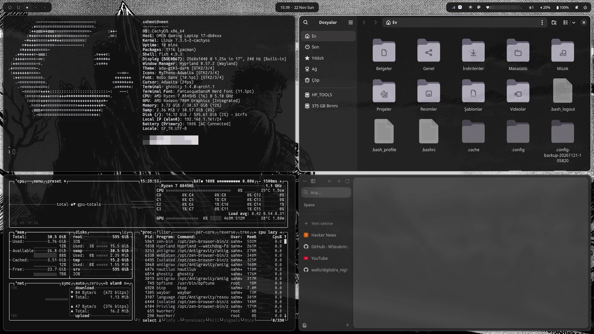

# dotfiles



*`FantasqueSansM Nerd Font` · `Noto Sans` · `adw-gtk3-dark` · Matugen 4.2 (`scheme-fidelity`)*

Hyprland 0.57+ (Lua) desktop configuration on **CachyOS (`No Desktop`)**. User configs are organized as **GNU Stow** packages (one directory per app); optional system-level power automation, `sched-ext`, and the custom Qt6 SDDM theme live under [`system/`](system/).

## Stack

| Layer | Tools |
| :--- | :--- |
| OS | CachyOS (`linux-cachyos`, Limine, Btrfs + Snapper) |
| Compositor | Hyprland 0.57+ (Lua API) |
| Display Manager | SDDM (`hypr-minimal`, custom Qt6 QML theme) |
| Bar & Notifications | Waybar, SwayNC |
| Launcher & Clipboard | Rofi (Wayland), `cliphist` |
| Terminal & Editor | Ghostty, `micro`, `btop` |
| Wallpaper & Theming | `awww`, Matugen 4.2 (`scheme-fidelity`) |
| Screenshots | `grim`, `slurp`, `satty` |
| Daily Apps | Zen Browser, Nautilus, Loupe, Celluloid, Pear Desktop |
| Power & Scheduler | `scx_lavd --autopower`, `power-profiles-daemon` |
| Packages | `pacman`, `paru` |

## Architecture

- **Unified Theme & Font Sync (`Super + Shift + T`):** Five curated palettes (`Catppuccin Mocha`, `Everforest`, `Gruvbox Dark`, `Kanagawa`, `Rosé Pine`) or wallpaper-derived Material colors via Matugen 4.2. A single script propagates colors and fonts across Hyprland, Waybar, Rofi, SwayNC, Ghostty, `btop` (TTY), `micro` (ANSI-16), GTK3/GTK4 (Libadwaita 1.10+ `:root`), Pear Desktop, and SDDM.
- **AC / Battery Automation:** `udev`, `systemd`, and `power-mode-sys` switch hardware and session settings automatically on power changes — `balanced` on AC (240 Hz, effects enabled) and `power-saver` on battery (60 Hz, CPU boost, blur, and animations disabled, AMD ABM and `pcie_aspm` enabled).
- **Clean Working Tree:** The 12 color/font files regenerated by `theme-apply` and `font-apply` are marked with `git update-index --skip-worktree`, keeping `git status` clean across theme switches.

## Usage

### Option 1: Pick individual configs (recommended)

Every top-level folder is a standalone GNU Stow package mirroring `$HOME`. Browse and copy only what you need, or stow individual components:

```bash
git clone https://github.com/sahmet-t/dotfiles.git ~/.dotfiles
cd ~/.dotfiles

# Example: link only Waybar and Ghostty
stow --target="$HOME" waybar ghostty
```

> **Note:** Dynamic configs import generated color/font files (`colors.css`, `colors.lua`, `font.css`, etc.). Default values are included in the repo so each component works out of the box; for live switching, also grab `matugen/`, `themes/`, and `scripts/`.

### Option 2: Full installation (Arch / CachyOS)

> **Note:** `install.sh` targets an HP Omen 17-db0015nt (AMD Ryzen 7 8845HS / Radeon 780M, `eDP-1` 2560×1440 @ 240 Hz, scale `1.25`, `tr` keyboard layout, dual-boot RTC). Inspect [`install.sh`](install.sh), [`hyprland.lua`](hypr/.config/hypr/hyprland.lua), and [`system/`](system/) before running it on another machine.

```bash
git clone https://github.com/sahmet-t/dotfiles.git ~/.dotfiles
cd ~/.dotfiles
chmod +x install.sh && ./install.sh
```

Optional system setup (power profiles, `scx_lavd`, and SDDM theme):

```bash
sudo ~/.dotfiles/system/apply-system.sh
```

## Keybinds

| Keybind | Action |
| :--- | :--- |
| `Super + Enter` | Terminal (Ghostty) |
| `Super + Space` | App launcher (Rofi) |
| `Super + W` / `Super + E` | Zen Browser / Nautilus |
| `Super + Shift + T` | Theme, wallpaper & font menu |
| `Super + Shift + S` / `Print` | Region / fullscreen screenshot (Satty) |
| `Super + Shift + V` | Clipboard history |
| `Super + N` / `Super + B` | Notification center / toggle Waybar |
| `Super + Q` / `F` / `V` | Close / fullscreen / float |
| `Super + 1..5` / `Super + -` | Workspaces / scratchpad |
| `Super + Esc` / `Super + Shift + Esc` | Lock (`hyprlock`) / power menu |

## Layout

```text
.
├── assets/             # README preview screenshots
├── btop/               # System monitor inheriting Ghostty TTY palette
├── ghostty/            # Terminal config, theme, and font hooks
├── gtk/                # GTK3 and GTK4/Libadwaita color definitions
├── hypr/               # Hyprland Lua config, hyprlock, hypridle, hyprsunset
├── matugen/            # Wallpaper-to-palette templates
├── micro/              # ANSI-16 Ghostty-synced editor theme and settings
├── paru/               # AUR helper configuration
├── rofi/               # Launcher and menu themes
├── scripts/            # ~/.local/bin utilities (theme-menu, power-mode, screenshot...)
├── swaync/             # Notification daemon config and styles
├── themes/             # Curated color palettes (palette.env)
├── waybar/             # Status bar modules and styling
├── system/             # /etc, /usr/local/bin, package lists, and SDDM theme
└── install.sh          # Stow and user environment installer
```

## License

[MIT](LICENSE)
